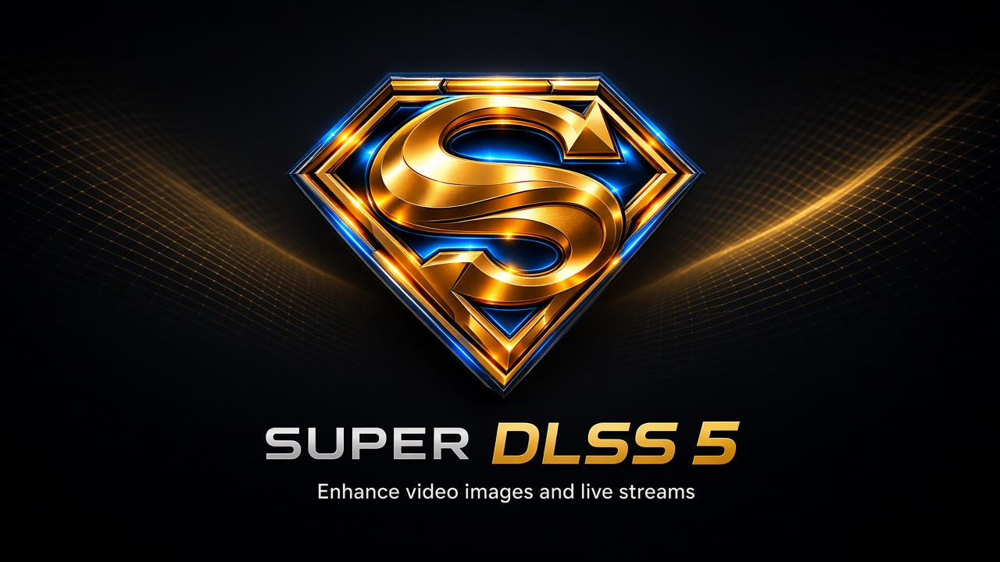
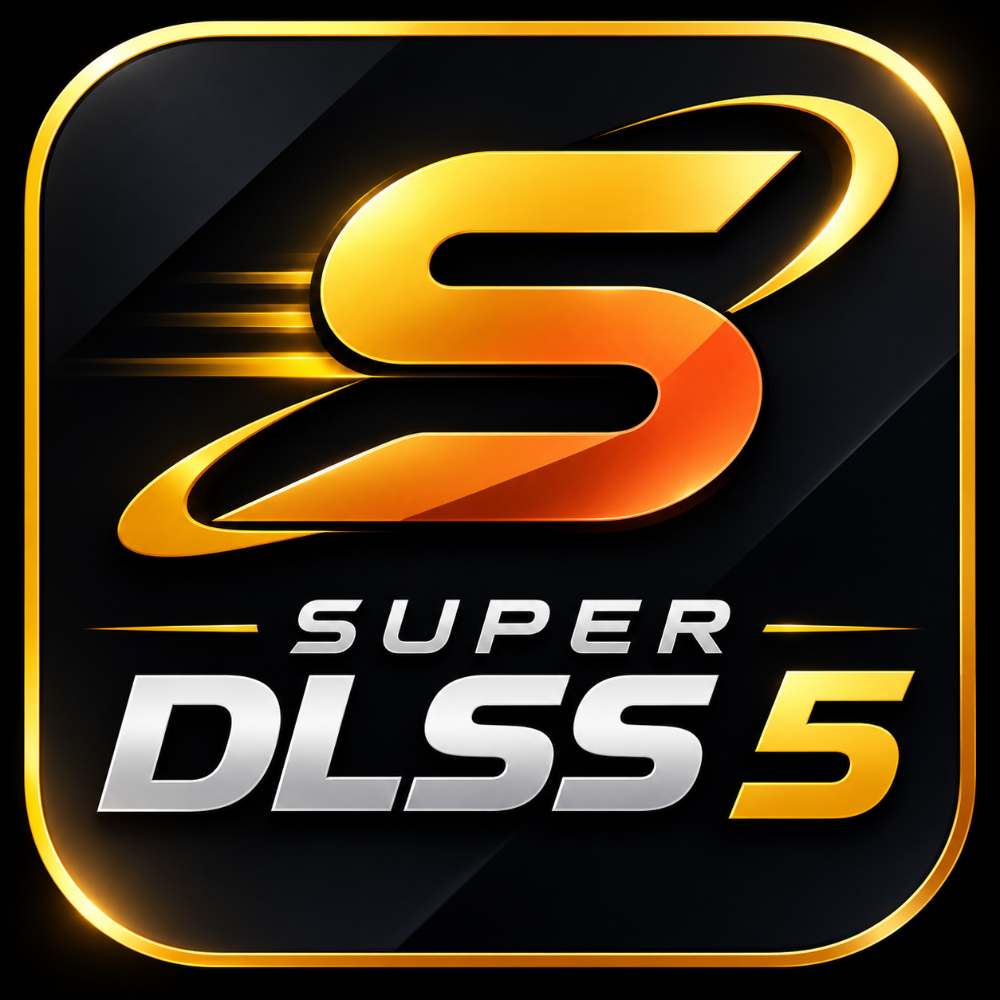

  

  

<h1 align="center">Super DLSS 5</h1>

  <strong>Windows desktop app for AI video, image &amp; live enhancement</strong> 
  Powered by <strong>NVIDIA DLSS 5 Neural Rendering</strong> — plus TikTok Optimizer and OBS Live.

  
  
  

  
  
  
  
  
  

---

## What is Super DLSS 5?

**Super DLSS 5** (also searched as *Super DLLS* / *Super DLLS 5*) is a commercial Windows application that enhances **video**, **still images**, and **live streams** using **NVIDIA DLSS 5 Neural Rendering**.

One window, multiple workflows:

| Workspace | What it does |
| --- | --- |
| **Video** | Batch-enhance clips with Neural Rendering, look presets, preview compare, and Good / Best / Max export tiers |
| **Image** | Still-image enhancement with the same neural stack — ideal for thumbnails and social posts |
| **Frame Interpolation** | Raise frame rate with DLSS frame generation engines (Auto, Native DLSSG, Cascade) |
| **Live** | Enhance streams **Online**, **Local**, or through **OBS** for long broadcasts |
| **TikTok Optimizer** | Prepare MP4s for TikTok with **Bypass TikTok Compression** and no-lag / same-quality tiers |
| **Settings** | GPU & DLSS architecture, daily credits, free-credit marketing submissions, activation codes, in-app updates |

Official site & downloads: **[https://superdlls.vercel.app](https://superdlls.vercel.app/)**

---

## See the difference

The same clip — before and after. Compare on the website:

**[Open interactive before / after →](https://superdlls.vercel.app/#compare-heading)**  
*Before · 540p 30fps → After · 4K 120fps*

  

---

## Main features

### Neural Rendering (Video & Image)

Enhance media with NVIDIA DLSS 5 Neural Rendering controls that exist in the app:

| Control | Options in Super DLSS 5 |
| --- | --- |
| **NR Preset** | Default, Preset #1, #2, #3 |
| **NR Style** | Default, Natural, Cinematic |
| **DLSS Model Preset** | Default, J, K, L, M |
| **Upscaling** | 1× DLAA / native · 1.5× Quality · 1.724× Balanced · 2× Performance · 3× Ultra Performance |
| **Tuning** | NR Intensity, Local Tone, Local Structure, Skin Structure |
| **Automatic mask** | On / Off |
| **Look presets** | Built-in looks (e.g. Default, Wet Floor Shine, Dry Natural) + import / export / user presets |
| **Preview compare** | Compare two look presets on one frame before exporting |
| **Export tiers** | **Good** · **Best** · **Max** (credit-metered quality tiers) |
| **HDR Mode** | Available with 10-bit capable codecs (H.265, AV1, ProRes Proxy) |
| **DLSS 5 Architecture** | Auto, Turing+, Ada Lovelace+, Blackwell+ (matches RTX 20/30 / 40 / 50 class GPUs) |

Output size is capped at the supported **7680×4320** boundary for the selected upscaling mode.

### Frame Interpolation

| Item | Details |
| --- | --- |
| **Engines** | Auto · Native DLSSG · Cascade |
| **Target FPS** | 23.976 → 480 (including 30, 60, 120, 144, 240, …) |
| **Export** | Same Good / Best / Max tiers, containers, and codecs as video |

### Live

| Mode | Purpose |
| --- | --- |
| **Online** | Enhance a live online source (HLS path) |
| **Local** | Local live enhancement |
| **OBS** | OBS plugin / control integration for long sessions with a **daily OBS Live** credit allowance |

Live quality helpers include max height (480–2160), FPS (Auto / Source / 60 / 30 / 24), and Fast / Quality guides.

### TikTok Optimizer

Dedicated tab to prepare H.264 + AAC MP4s for TikTok:

- **Bypass TikTok Compression** (required) — reduces TikTok re-encoding damage on upload  
- **Max (Same quality)** — keeps quality / bitrate when you want fidelity  
- **Best (No lag)** — lighter bitrate for smoother playback  
- **Good (No lag)** — stronger size reduction for large files  
- If source bitrate is already below the Good/Best target, bitrate is left unchanged and only bypass is applied

### Account, credits & updates

- **Discord sign-in** from the desktop app (browser opens the official site)
- **Daily processing credits** with server-managed costs (Good / Best / Max, Live Online / Local, OBS Live daily)
- **Subscribe** for more credits · **activation codes** · **earn free credits** by submitting marketing videos (YouTube / TikTok) from Settings
- **In-app updates** when a new signed release is published
- Optional **Android** companion link when published on Google Play (shown on the website and in Settings)

---

## Supported media

| Type | Input / notes | Output |
| --- | --- | --- |
| **Video** | Common formats via the bundled FFmpeg stack (MP4 and related) | Containers: **MP4**, **MKV**, **MOV** |
| **Codecs** | — | H.264 · H.265 · AV1 · ProRes Proxy (CPU or **NVIDIA NVENC** where listed) |
| **Images** | Still images through the Image workspace | **PNG**, **JPEG**, **WebP**, **AVIF**, **TIFF** |
| **TikTok** | MP4 (H.264 + AAC) | Optimized MP4 for upload |

---

## Requirements

- **OS:** Windows 10 / 11, 64-bit  
- **GPU:** **NVIDIA GeForce RTX** recommended (DLSS 5 Neural Rendering / frame generation / NVENC)  
- **Driver:** Current Game Ready / Studio driver  
- **Architecture builds:** Auto selects Turing+ (RTX 20/30), Ada Lovelace+ (RTX 40), or Blackwell+ (RTX 50)  
- **Account:** Discord login for quota-backed processing  
- **Internet:** Required for sign-in, credit checks, updates, and Live Online

---

## Installation

1. Open **[https://superdlls.vercel.app](https://superdlls.vercel.app/)**  
2. Download the **Windows installer** (or portable ZIP when published)  
3. Install / extract and run **Super DLSS 5**  
4. Click **Sign in** → finish Discord authorization in the browser  
5. Return to the app — your session is delivered automatically  
6. Start with **Video**, **Image**, **Frame Interpolation**, **Live**, or **TikTok Optimizer**

Installer and portable builds are also published under  
[GitHub Releases](https://github.com/mabdo5/superdlls5/releases) when a version is tagged.

---

## Credits (overview)

Processing is metered so the service stays fair. Defaults shown on the site (server can update them without a reinstall):

| Action | Typical cost |
| --- | --- |
| Daily allowance | Processing credits refresh each day |
| Export **Good** / **Best** / **Max** | 1 · 2 · 3 credits |
| Live Online / Local | Per-session credit use |
| OBS Live | Separate **daily** OBS allowance |

Need more? Subscribe, redeem an activation code, or earn bonus credits via the marketing workflow in **Settings → Free credits**.

---

## About this repository

This public repository hosts:

- Product landing / bootstrap metadata used by the Super DLSS 5 ecosystem  
- Release artifacts (when published)  
- Security / control-plane documentation relevant to signed updates  

The full desktop application source and private recovery materials live in a separate private repository for the owner.

**Privacy & Terms:** [Privacy](https://superdlls.vercel.app/privacy) · [Terms](https://superdlls.vercel.app/terms)

---

## NVIDIA notice

Super DLSS 5 is an independent product and is **not** affiliated with, sponsored by, endorsed by, or an official product of **NVIDIA Corporation**.

NVIDIA, GeForce, RTX, DLSS, and related names and marks belong to their respective owners. Any NVIDIA-owned software, runtime, SDK component, or binary remains subject to its own license and distribution terms.

TikTok is a trademark of its respective owner. Discord is a trademark of Discord Inc. OBS Studio is a trademark of the OBS Project.

---

## Links

| | |
| --- | --- |
| Website | https://superdlls.vercel.app |
| Releases | https://github.com/mabdo5/superdlls5/releases |
| Issues | https://github.com/mabdo5/superdlls5/issues |

  

  Copyright © Super DLSS 5 · All rights reserved

